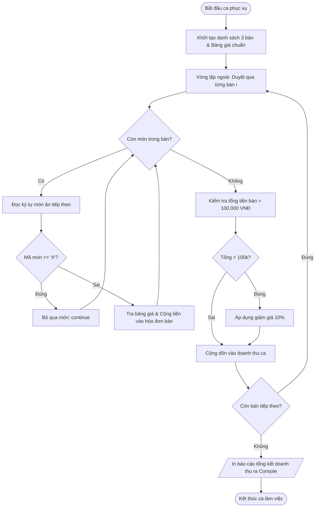

# BÁO CÁO BÀI TẬP: XÂY DỰNG HỆ THỐNG QUÉT TỒN KHO VÀ CẢNH BÁO HẾT HÀNG TỰ ĐỘNG

> 👤 **Học viên:** Hoàng Công Dũng | **Mã SV:** PTIT-HCM-009
> 🏫 **Môn học:** it103b-rl-HoangCongDung

---

## 📊 Sơ đồ thiết kế hệ thống (Flowchart)

> 💡 *Sơ đồ dưới đây được render tự động trực tiếp trên GitHub bằng Mermaid. Bạn cũng có thể tải file **`bt3.drawio`** trong repository này để mở và chỉnh sửa trực tiếp trên [Draw.io (diagrams.net)](https://app.diagrams.net).* 

---

## 1. Mục tiêu và Bối cảnh bài toán

Bài tập này yêu cầu vận dụng thành thạo cấu trúc vòng lặp lồng nhau (Nested Loops) kết hợp với các câu lệnh điều khiển luồng như 'continue' để xử lý chuỗi ký tự món ăn đa bàn tại Highlands Coffee.

Mục tiêu kỹ thuật là kiểm soát chính xác từng ký tự trong chuỗi gọi món của từng bàn, bỏ qua các mặt hàng có mã hủy 'X' và áp dụng chính sách chiết khấu linh hoạt theo ngưỡng doanh thu của từng bàn trước khi tổng kết ca làm việc.

- Sử dụng vòng lặp ngoài để duyệt danh sách các bàn phục vụ.
- Sử dụng vòng lặp trong để duyệt qua từng ký tự món ăn tương ứng với từng bàn.
- Xử lý ngoại lệ với ký tự 'X' (món hủy) bằng lệnh 'continue'.

## 2. Phân tích Quy tắc Nghiệp vụ và Bẫy Dữ liệu

Để đảm bảo tính chính xác của hóa đơn, chương trình cần tuân thủ nghiêm ngặt bảng giá chuẩn và quy tắc chiết khấu được quy định trong đề bài.

Các trường hợp đặc biệt như bàn gọi món có chứa mã hủy 'X' hoặc hóa đơn vượt ngưỡng 100.000 VNĐ được xử lý tự động thông qua các câu lệnh điều kiện lồng cấp.

- Bảng giá chuẩn: Size S ('S' = 35.000), Size M ('M' = 42.000), Size L ('L' = 48.000), Topping ('T' = 10.000), Hủy ('X' = 0).
- Chính sách chiết khấu: Hóa đơn bàn nào vượt quá 100.000 VNĐ sẽ được giảm ngay 10% trên tổng tiền bàn đó.
- Tổng kết ca: Cộng dồn doanh thu thực thu của tất cả các bàn để in báo cáo cuối ca.

## 3. Bảng đặc tả chi tiết quy trình thuật toán

Bảng dưới đây mô tả chi tiết các bước thực hiện của thuật toán duyệt đơn hàng qua vòng lặp lồng nhau:

| Bước | Thực thể / Vòng lặp | Hành động thực hiện | Điều kiện / Kết quả |
| --- | --- | --- | --- |
| 1 | Khởi tạo | Khai báo mảng chứa chuỗi món ăn của 3 bàn và bảng giá chuẩn | Sẵn sàng dữ liệu đầu vào cho ca làm việc |
| 2 | Vòng lặp ngoài | Duyệt qua từng bàn (Bàn 1, Bàn 2, Bàn 3) | Xác định phạm vi xử lý cho từng bàn khách |
| 3 | Vòng lặp trong | Duyệt qua từng ký tự món ăn trong chuỗi của bàn hiện tại | Đọc mã món để tính tiền |
| 4 | Kiểm tra mã món | So sánh mã ký tự với 'X' | Nếu là 'X' thì thực hiện 'continue' để bỏ qua |
| 5 | Tính tiền món | Tra bảng giá tương ứng (S, M, L, T) và cộng dồn vào hóa đơn bàn | Cập nhật tạm tính của bàn |
| 6 | Kiểm tra chiết khấu | Kiểm tra tổng tiền bàn có vượt mức 100.000 VNĐ hay không | Nếu vượt quá, áp dụng giảm giá 10% |
| 7 | Tổng kết ca | Cộng dồn doanh thu thực thu của từng bàn vào biến tổng ca | In báo cáo chi tiết ra Console |

## 4. Hướng dẫn cấu trúc Repository và Nộp bài

Mã nguồn được viết hoàn chỉnh bằng Javascript và lưu tại tệp 'solution_ex7.js' trong thư mục của repository GitHub cá nhân.

Đường dẫn Organization nộp bài: 'it103b-rl-HoangCongDung'. Toàn bộ code đã được kiểm thử với các tình huống gọi món có chứa mã hủy 'X' và các bàn vượt ngưỡng giảm giá 10%.

- Tên file bắt buộc: 'solution_ex7.js'.
- Đảm bảo cú pháp sạch sẽ, tuân thủ chuẩn ES6+.
- Commit và Push code lên nhánh chính của repository trước khi nộp trên hệ thống LMS.

---

## 📁 Danh sách tệp tin nộp bài trong Repository
- 📝 `bt3.docx`: Báo cáo tài liệu phân tích nghiệp vụ hoàn chỉnh.
- 🎨 `bt3.drawio`: File thiết kế sơ đồ chuẩn theo quy định đề bài (mở trực tiếp bằng [Draw.io](https://app.diagrams.net) hoặc Lucidchart).
- 💻 `solution_ex7.js`: Mã nguồn chương trình.
